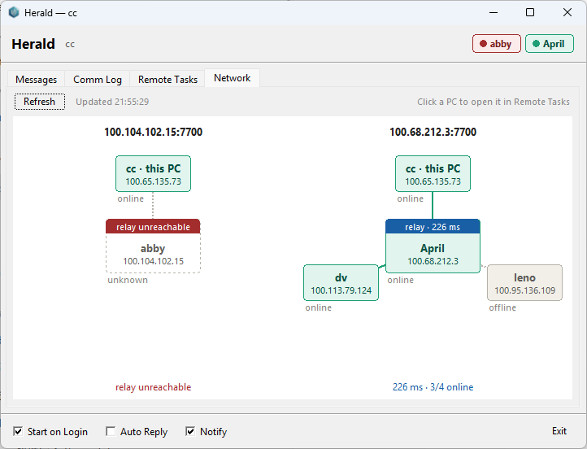

# System Tray UI

- **Launch:** Run `python herald_tray.py` (starts automatically on Windows startup after `--install`).
- **Left-click tray icon** to open the Herald window. Closing the window (X) hides it back to the tray; the connection keeps running.
- **Rename machine:** Click the machine name at the top of the window (saves to `config.json` immediately).
- **Exit:** Right-click tray icon → **Exit**, or the **Exit** button in the window.

## Tabs

| Tab | What it shows |
|-----|---------------|
| **Messages** | Incoming messages and file deposits from peers, as they arrive over SSE. |
| **Comm Log** | The full two-way log from `herald_comm.log`: every `exec_shell` and `ask_peer` sent or received. |
| **Remote Tasks** | Run a preset (or typed) command on a peer and see its output, e.g. which `claude` / `python` processes are running there. Each peer is reached through the relay of the network it belongs to. |
| **Network** | Which PCs are connected right now, one diagram per relay (see below). |

## Network tab



Each relay in `config.json` (the top level plus every entry under `networks`) gets its own diagram. The relay is a program running on one of the PCs, so that PC sits in the middle with a coloured **relay band** across the top of its card; the network's other PCs are placed around it. The host appears only once.

| Mark | Meaning |
|------|---------|
| `online` under a green box, solid line | The PC's tray holds a live connection to this relay |
| `offline` under a grey box, dashed line | No tray connected from that PC |
| `unknown` under a white dashed box | The relay is unreachable, or runs an older `server.py` that does not report who is online |
| `· this PC` after the name | This PC: online whenever any relay answers |
| Blue band, `relay · N ms` | The relay is up, running on that PC |
| Red band, `relay unreachable` | The relay cannot be reached; every line to it is grey |
| Plain "relay" box in the middle | The relay's host PC could not be identified (see [Showing IP addresses](#showing-ip-addresses)) |

Below each diagram: the round-trip time to the relay and how many of its peers are online.

- **Click a PC** to jump to Remote Tasks with that peer selected.
- The tab refreshes when you open it, then every 15 seconds while it stays open. Nothing is polled while the window is hidden.
- Peers come from each network's `peers` list in `config.json`. A PC that is connected but missing from that list will not be drawn.
- This PC's tray subscribes only to the **top-level** relay: peers in other networks cannot send commands to it, but it can still send to them. The diagram therefore shows it online in every network whose relay answers.

### Relay pills in the title bar

One pill per relay, named after the PC it runs on: **green** reachable, **red** not, grey before the first check. The first pill (the top-level relay) follows the tray's own subscription, so green there means other PCs can send commands to this one. Hover a pill for the relay address and round-trip time. Pills refresh every 15 seconds while the window is open.

### Showing IP addresses

Add an optional `ips` map to `config.json` to print each peer's address under its name (this PC's own address comes from `tailscale ip -4`). It also lets the tab name the host of a relay that is down, by matching the relay URL's IP:

```json
"ips": {
  "April": "100.68.212.3",
  "leno": "100.95.136.109"
}
```

### Relay requirement

The online/offline state comes from the relay's `/health` endpoint, which returns `"online": [...]`, the peers whose tray is subscribed at that moment. Relays running an older `server.py` show every peer as `?` until they are updated and restarted.

## Bottom bar

- **Start on Login:** Adds or removes the Windows startup entry.
- **Auto Reply:** Invokes Claude once per incoming chat message to answer it (event-driven, no cost while idle).
- **Notify:** Shows a Windows toast when a peer runs a command, sends a file or talks to this PC's AI (at most one per peer per minute).
